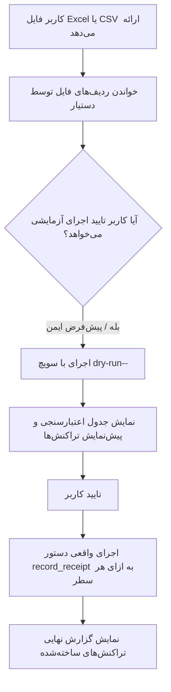

# پروتکل پردازش و ثبت دسته‌ای تراکنش‌ها از اکسل و CSV
# Batch Receipt Ingestion Protocol (Excel & CSV)

این سند راهنمای عملیاتی و استاندارد رفتار سیستم هوش مصنوعی (Antigravity) در هنگام دریافت فایل‌های دسته‌ای اکسل (`.xlsx`) یا متنی (`.csv`) حاوی تراکنش‌های مالی خوابگاه است.

---

## 🧭 ۱. جریان کاری کلی (Workflow)



---

## 📋 ۲. ساختار ستون‌های پشتیبانی‌شده در فایل ورودی

سیستم فایل‌های اکسل و CSV را با هدرهای فارسی یا انگلیسی زیر شناسایی می‌کند:

| ستون فارسی معادل | ستون انگلیسی | الزامی؟ | توضیحات |
| :--- | :--- | :---: | :--- |
| `نام مقیم` / `نام ساکن` / `نام` | `resident` / `name` | **بله** | نام و نام‌خانوادگی مقیم |
| `شماره اتاق` / `اتاق` | `room` / `room_number` | اختیاری | شماره اتاق جهت تطبیق فازی دقیق‌تر مقیم |
| `مبلغ اجاره (تومان)` / `اجاره` | `rent_tomans` / `rent` | خیر | سهم اجاره به تومان (در صورت خالی بودن: ۰) |
| `مبلغ ودیعه (تومان)` / `ودیعه` | `deposit_tomans` / `deposit` | خیر | سهم ودیعه به تومان (در صورت خالی بودن: ۰) |
| `تاریخ و زمان` / `تاریخ` | `date` / `datetime` | **بله** | تاریخ شمسی به همراه ساعت (مثال: `1405/08/06 19:08:34`) |
| `اطلاعات رهگیری` / `پیگیری` / `مرجع` | `ref` / `reference` | خیر | کد پیگیری، شماره مرجع، نام بانک، ۴ رقم کارت |
| `روش پرداخت` / `نوع پرداخت` | `method` | خیر | `کارتخوان` (CARD) یا `کارت به کارت` (BANK_TRANSFER) |
| `تسویه تا` / `تاریخ تسویه` | `settled_until` | خیر | تاریخ پایان تسویه اجاره (مثال: `1405-09-01`) |
| `توضیحات` | `desc` / `description` | خیر | یادداشت یا توضیحات تراکنش |

---

## ⚙️ ۳. نحوه اجرای ثبت توسط دستیار (AI Execution Commands)

هنگامی که کاربر فایلی را در مسیر پروژه قرار می‌دهد یا محتوای CSV را ارسال می‌کند، دستیار مستقیماً از دستور استاندارد سیستم (`record_receipt`) استفاده می‌نماید:

### سناریوی ۱: پردازش فایل با اسکریپت مانیتورینگ خودکار
دستیار می‌تواند فایل اکسل یا CSV را از طریق یک حلقه تمیز در پایتون خوانده و با دستورات ثبت کند:

```python
# الگو برای پردازش سطر به سطر:
# .venv/bin/python manage.py record_receipt \
#   --resident "<نام مقیم>" \
#   --room "<شماره اتاق>" \
#   --rent-tomans <مبلغ اجاره> \
#   --deposit-tomans <مبلغ ودیعه> \
#   --date "<تاریخ و ساعت>" \
#   --ref "<اطلاعات فیش>" \
#   --method <CARD|BANK_TRANSFER> \
#   [--settled-until "<تاریخ تسویه>"] \
#   [--desc "<توضیحات>"]
```

### سناریوی ۲: قوانین مهم در حین پردازش دسته‌ای
1. **تراکنش‌های تفکیکی (Split):** اگر در یک سطر هم ستون اجاره و هم ستون ودیعه پر باشد، دستور با داشتن همزمان `--rent-tomans` و `--deposit-tomans` به صورت خودکار دو تراکنش اتمیک متصل به هم تولید می‌کند.
2. **بررسی مقیمان پیش از ثبت:** اگر مقیمی در سیستم پیدا نشد، دستیار نباید کل فرایند را متوقف کند؛ بلکه آن سطر را با ذکر نام و اتاق در جدول خطاها گزارش داده و سایر سطور را پردازش می‌کند.
3. **ارقام و مقادیر ریال/تومان:** مبالغ داخل فایل حتماً به **تومان** فرض می‌شوند و دستور جنگو به صورت بومی آن‌ها را با ضرب در ۱۰ به ریال در دیتابیس ثبت می‌کند.

---

## 📊 ۴. قالب گزارش نهایی پس از ثبت فایل دسته‌ای

پس از پردازش فایل، خروجی به کاربر به این صورت ارائه می‌شود:

```markdown
### 📋 خلاصه ثبت دسته‌ای فیش‌ها از فایل: [نام_فایل]
- **تعداد کل ردیف‌ها:** ۱۵
- **تراکنش‌های موفق:** ۱۴
- **ردیف‌های ناموفق / نیازمند بررسی:** ۱ (علت: مقیم در سامانه ثبت‌نام نشده)
- **مجموع مبالغ ثبت‌شده:** ۵۴,۵۰۰,۰۰۰ تومان (اجاره: ۴۴,۵۰۰,۰۰۰ | ودیعه: ۱۰,۰۰۰,۰۰۰)

| ردیف | شناسه (#ID) | نام مقیم | اتاق | مبلغ (تومان) | نوع | دوره / تسویه | وضعیت |
| :---: | :---: | :---: | :---: | :---: | :---: | :---: | :---: |
| ۱ | #380, #381 | رسول خدادوست | ۱۲۷ | ۷,۵۰۰,۰۰۰ | ودیعه + اجاره | تا ۱۴۰۵/۰۹/۰۱ | ✅ موفق |
...
```

