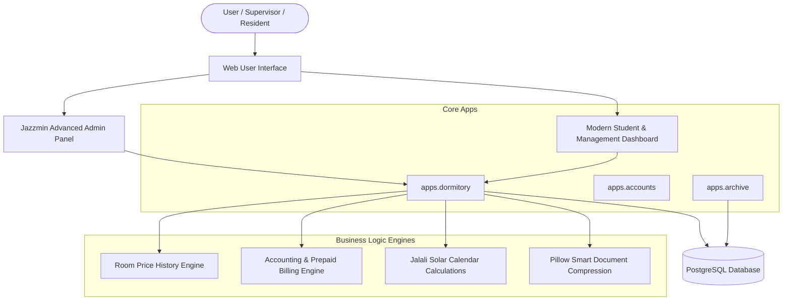
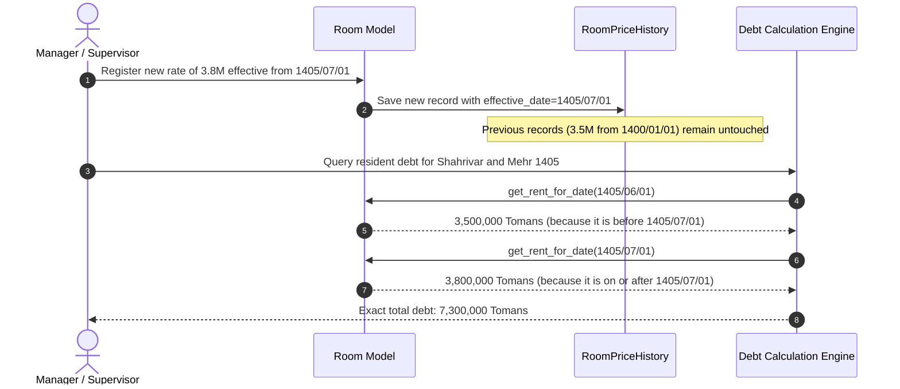
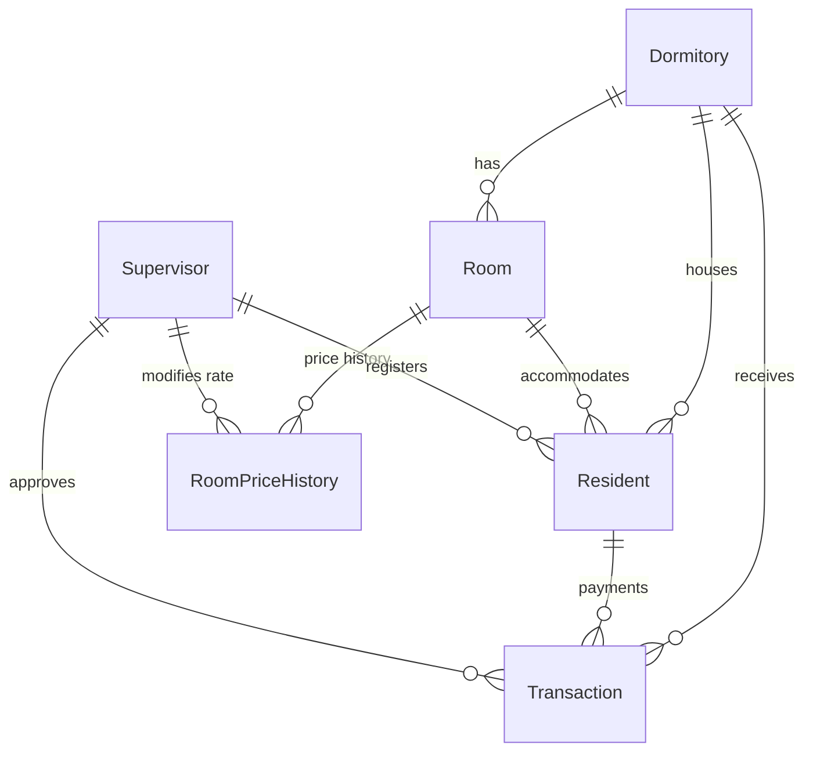
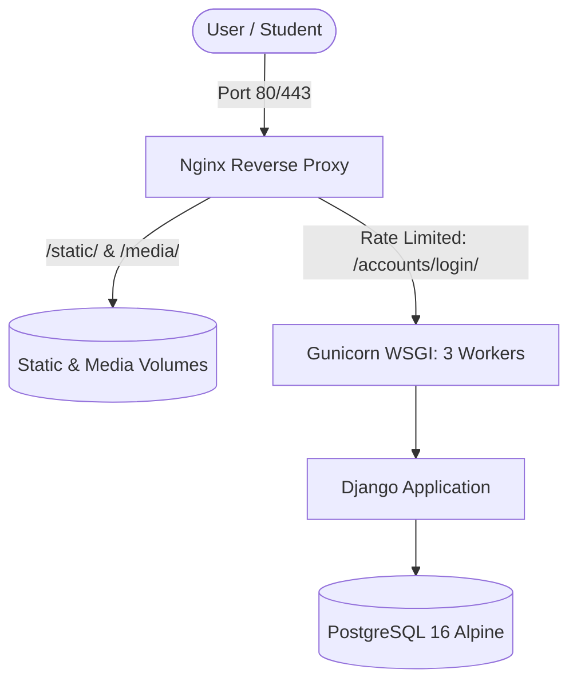

# Technical Documentation and Comprehensive Architecture Guide: Dormitory Management System

This document serves as the technical and engineering reference for all dormitory software subsystems, computational logic, database architecture, and system workflows. The purpose of this guide is to provide complete clarity on how the system operates for developers, technical managers, dormitory executive staff, and AI automation agents.

---

## Table of Contents
1. [High-Level System Architecture (System Architecture)](#1-high-level-system-architecture)
2. [Room Price History and Effective Date Pricing Engine (Room Price History Engine)](#2-room-price-history-and-effective-date-pricing-engine)
3. [Prepaid Accounting, Daily Calculation, and Rental Periods (Prepaid Accounting & Billing Engine)](#3-prepaid-accounting-daily-calculation-and-rental-periods)
4. [Transaction Lifecycle, Payments, and Automatic Settlement (Transaction Lifecycle)](#4-transaction-lifecycle-payments-and-automatic-settlement)
5. [Resident Identity Profile, Foreign Nationals, Image Compression, and Missing Documents Engine (Resident Identity & Documents Engine)](#5-resident-identity-profile-foreign-nationals-image-compression-and-missing-documents-engine)
6. [Native Solar Hijri Calendar Calculations (Jalali Date Engine)](#6-native-solar-hijri-calendar-calculations)
7. [Admin User Interface, Themes, and Dashboards (UI & Dashboard Integrations)](#7-admin-user-interface-themes-and-dashboards)
8. [Database, Models, and Test Coverage (Database, Models & Tests)](#8-database-models-and-test-coverage)
9. [Student Authentication Infrastructure and Production Deployment Architecture (Docker & Deployment)](#9-student-authentication-infrastructure-and-production-deployment-architecture-docker--deployment)
10. [AI Agent Operational Directives: Transaction Auditing, Fraud Detection & Receipt Validation (CRITICAL)](#10-ai-agent-operational-directives-transaction-auditing-fraud-detection--receipt-validation-critical)

---

## 1. High-Level System Architecture

This system is developed as a centralized, unified web application built on the Django framework and a PostgreSQL database.



### Application Structure:
- `apps.dormitory`: The core module managing dormitories (`Dormitory`), rooms (`Room`, `RoomPriceHistory`), residents (`Resident`), transactions (`Transaction`), and daily notes (`DailyNote`).
- `apps.dashboard`: Views and APIs for the modern single-page dashboard, statistical cards, dual-theme system, resident lists, and profile detail modals.
- `apps.accounts`: Authentication and permissions for dormitory supervisors (`Supervisor`).
- `apps.archive`: Permanent archive of departed residents' records and deleted transactions to keep the primary operational tables lightweight.

---

## 2. Room Price History and Effective Date Pricing Engine

### Technical Challenge:
In dormitories, room rents may increase during the year (for example, an increase from 3.5 million Tomans to 3.8 million Tomans starting at the beginning of Autumn). In traditional systems, modifying the `monthly_rent` field directly caused severe errors:
- Calculations and financial reports for past months became corrupted.
- Residents who had already settled previous months were erroneously marked as debtors, or the amounts on previous receipts were altered.
- Overdue debts from previous months were calculated using the new rate rather than the rate that was in effect during that specific period of residence.

### Implemented Solution (Effective Date History Pattern):
To fundamentally solve this problem, the `RoomPriceHistory` model and an effective-date history structure were implemented.



### Structure of the `RoomPriceHistory` Model:
```python
class RoomPriceHistory(models.Model):
    room = models.ForeignKey('dormitory.Room', on_delete=models.CASCADE, related_name='price_history')
    monthly_rent = models.PositiveBigIntegerField(help_text="مبلغ اجاره به ریال") # Rent amount in Rials
    effective_date = jmodels.jDateField(help_text="تاریخ شروع اعمال نرخ") # Rate effective start date
    created_at = models.DateTimeField(auto_now_add=True)
    created_by = models.ForeignKey('accounts.Supervisor', on_delete=models.SET_NULL, null=True, blank=True)
    note = models.CharField(max_length=255, blank=True, default="")
```

### Retrieving the Rate by Date (`get_rent_for_date`):
```python
def get_rent_for_date(self, target_date: Optional[jdatetime.date] = None) -> int:
    if target_date is None:
        target_date = jdatetime.date.today()
    
    # Fetch the latest rate whose effective_date is less than or equal to target_date
    history = self.price_history.filter(effective_date__lte=target_date).order_by('-effective_date', '-id').first()
    if history:
        return history.monthly_rent

    # If the target date is earlier than all recorded history entries, return the earliest recorded rate
    earliest = self.price_history.order_by('effective_date', 'id').first()
    if earliest and target_date < earliest.effective_date:
        return earliest.monthly_rent

    return self.monthly_rent
```

### Bulk Room Price Change (`bulk_change_price`):
In the Django Admin panel, a custom `bulk_change_price` action enables selecting dozens of rooms simultaneously and specifying a new rate, effective date, and reason for the price change via a standardized form with two-step confirmation.

---

## 3. Prepaid Accounting, Daily Calculation, and Rental Periods

The system operates entirely on a **Prepaid Model**; meaning each month's rent is collected at the beginning of the monthly period, not at the end of it.

### Core Accounting Concepts:
1. **`entry_date` (Entry Date)**: The date the resident moved into the dormitory.
2. **`settled_until` (Settled Until Date)**: The resident's settled time boundary. No debt exists up to this date.
3. **`next_due_date` (Next Due Date)**: Equal to `settled_until` (or `entry_date` for residents who have not yet made any payments).
4. **`is_in_debt` (Debt Status)**:
   - If `settled_until` is null/empty and `today >= entry_date`, the resident is in debt.
   - If `settled_until` is set and `today >= settled_until`, the resident is in debt.
   - If `today < settled_until`, the account is completely up-to-date and settled.
5. **`overdue_days` (Overdue Days Counter)**:
   $$\text{overdue\_days} = \max(0, (\text{today} - \text{settled\_until}).\text{days})$$
6. **`debt_urgency` (Debt Urgency Level)**:
   - `'settled'`: Up-to-date settlement (`is_in_debt == False`)
   - `'warning'`: 1 to 7 days overdue (weekly grace period for payment, displayed with a yellow warning indicator)
   - `'danger'`: More than 7 days overdue (definitive debt, displayed with a red danger indicator)

### Breakdown of Unpaid Monthly Periods (`calculate_unpaid_periods`):
Rent in the system is calculated on a **flat monthly basis** (not fractional daily penalties). This method steps forward month-by-month from `settled_until` up to the current date and invokes `rent_resolver` to extract the approved rate for that specific time period:

```python
# The output for each period is structured as follows:
{
    "start_date": jdatetime.date(1405, 6, 1),
    "end_date": jdatetime.date(1405, 7, 1),
    "name": "اجاره شهریور ماه ۱۴۰۵", # Rent for Shahrivar 1405
    "overdue_days": 25,
    "amount_rials": 35000000,
    "amount_tomans": 3500000
}
```

### Multi-Rate Combined Debt Calculation:
The resident's total debt is calculated using the following property:
```python
@property
def total_debt_amount_tomans(self) -> int:
    return sum(p["amount_tomans"] for p in self.unpaid_periods)
```
This structure guarantees that even if a room undergoes multiple price increases over time, each unpaid month is invoiced strictly at the legal rate applicable to that specific month.

---

## 4. Transaction Lifecycle, Payments, and Automatic Settlement

The `Transaction` model is an immutable record of financial payments.

### Transaction Types and Payment Methods:
- **`transaction_type`**:
  - `RENT`: Monthly rent
  - `DEPOSIT`: Housing security deposit
- **`payment_method`**:
  - `CARD`: Account-linked POS terminal
  - `ONLINE_GATEWAY`: Online payment gateway
  - `CASH`: Cash payment
  - `BANK_TRANSFER`: Card-to-card / Bank transfer receipt

### The `applicable_rent` Field:
When registering a rent transaction (`RENT`), the room's active monthly rate at the moment of payment or rental period is saved in the `applicable_rent` field. This field permanently freezes the rate for that payment and prevents subsequent room price increases from altering previously issued receipts.

### Immediate Application and Advancement of `settled_until` Across All Payment Methods:
All registered payments (Cash, Bank Transfer/Card-to-Card, POS Card, Online Gateway) **immediately affect the settlement date (`settled_until`) upon registration in the system**, advancing it by the covered rental period (even if the `is_approved` administrative verification checkbox has not yet been ticked):
```python
if self.transaction_type == self.TransactionType.RENT and self.period_end:
    res = self.resident
    if res and (not res.settled_until or self.period_end > res.settled_until):
        res.settled_until = self.period_end
        res.save(update_fields=['settled_until'])
```
This mechanism ensures that as soon as a resident's receipt or card-to-card transfer is recorded, their settlement date automatically advances to the next month and removes them from debtor status. The `is_approved` flag solely indicates the final administrative review status by the supervisor.

---

## 5. Resident Identity Profile, Foreign Nationals, Image Compression, and Missing Documents Engine

### Native Support for Foreign Nationals (`is_foreign`):
- Binary field `is_foreign`: Specifies whether the resident is a non-Iranian national.
- When the foreign national option is selected, the 10-digit Iranian National Code format requirement is lifted, freeing the field to record a **Passport Number** or **Dedicated Foreign National Code (Farakir Code)**.

### Father's Name Field (`father_name`):
The father's name has been added to the model as a vital component of residency contracts and identity verification. During the validation step (`clean`), the system automatically sanitizes null-equivalent or invalid placeholder strings such as `"ندارد"` (none), `"-"`, and `"فاقد"` (lacking).

### Automatic Compression and Upload of Up to 3 Identity Document Images:
- Fields: `id_card_image` (front of ID card/passport), `id_card_image_2` (back of ID card/second page), and `id_card_image_3` (birth certificate/supplementary document).
- Using the `Pillow` library in `apps/dormitory/image_utils.py`, all incoming images—whether from mobile cameras or heavy file uploads—are compressed to under **1 MB** and rescaled to standard dimensions without loss of text legibility or visual clarity.

### Missing Documents Tracking Engine (`IncompleteProfileFilter`):
The system automatically monitors 5 core profile factors:
1. National Code or Passport Number (`national_code`)
2. Father's Name (`father_name`)
3. Parent or Guardian Phone Number (`parent_phone_number`)
4. Possession of a Lease Agreement (`has_lease`)
5. At least one uploaded identity document image (`has_id_card_image`)

If any of these items are missing, the incomplete status is displayed in admin badges, sidebar filters, and the dashboard.

### Profile Copy & Export System Without Financial Data:
To share personal resident details with the university, security office, or roommates, the `get_export_text` function copies clean Persian text containing personal details, room, bed, phone number, and document status to the clipboard without exposing payment histories or financial amounts.

---

## 6. Native Solar Hijri Calendar Calculations

One of the most sensitive technical components is the accurate calculation of month lengths and leap years in the Solar Hijri (Jalali) calendar, managed in `apps/dormitory/jalali_utils.py`.

### Safe Addition of Jalali Months (`add_jalali_months`):
In the Solar Hijri calendar, the first 6 months have 31 days, the next 5 months have 30 days, and Esfand has 29 days (or 30 days in a leap year). If a resident moves in on the 31st of Ordibehesht, adding 1 month must not trigger an invalid date error:
```python
def add_jalali_months(orig_date: jdatetime.date, months: int = 1) -> jdatetime.date:
    total_months = (orig_date.year * 12) + (orig_date.month - 1) + months
    new_year = total_months // 12
    new_month = (total_months % 12) + 1

    max_days = get_days_in_jalali_month(new_year, new_month)
    new_day = min(orig_date.day, max_days)
    return jdatetime.date(new_year, new_month, new_day)
```

### Smart Period Naming (`format_period_name`):
- Full calendar month period: `1405/07/01` to `1405/08/01` $\rightarrow$ **«اجاره مهر ماه ۱۴۰۵»** (Rent for Mehr 1405)
- Multi-month periods: `1405/07/01` to `1405/09/01` $\rightarrow$ **«اجاره مهر و آبان ماه ۱۴۰۵»** (Rent for Mehr and Aban 1405)
- Mid-month periods: `1405/07/15` to `1405/08/15` $\rightarrow$ **«اجاره دوره ۱۵ مهر تا ۱۵ آبان ۱۴۰۵»** (Rent for period 15 Mehr to 15 Aban 1405)

---

## 7. Admin User Interface, Themes, and Dashboards

1. **Jazzmin Admin Panel**:
   - Customized for the Persian language and Right-to-Left (RTL) layout.
   - Custom popup Solar Hijri calendar widget (`AdminPersianDateWidget`).
   - Custom actions: Bulk room price modification, clipboard export, Excel/CSV export, and archiving of departed residents.
2. **Single-Page Dashboard (`apps/dashboard`)**:
   - **Advanced Live Room Search in the Rooms Tab (`#search-room`)**: Instant room search by room number (supporting both Persian and English digits, e.g., `"۱۰۲"`, `"102"`, or `"اتاق ۱۰۲"`), names of current residents in the room and dormitory, accompanied by a dynamic matching rooms counter (`#rooms-count`).
   - **Room Filter and Search in the Students Tab**: Dedicated room selection dropdown (`#filter-room-select`) to display residents of a specific room, plus student search bar support for room numbers.
   - Advanced theme switcher (Classic Dark and Modern Slate) with glassmorphism effects.
   - Dynamic statistical cards: Total rooms, rooms with vacant beds, total debtors, current month revenue, and missing documents count.
   - Interactive modal displaying granular resident details and profile status with an itemized breakdown of unpaid debt periods.

---

## 8. Database, Models, and Test Coverage

### Entity-Relationship Diagram (ER Diagram):



### Running Automated Tests:
All computational logic, transaction rate freezing, and historical rate transitions are covered by unit and integration tests:
```powershell
# Run core system unit and validation tests:
venv\Scripts\python.exe manage.py test apps.dormitory --noinput
```

**Test Status**:
- Total Tests: **62 complete tests**
- Success Rate: **100% (OK)**
- Execution Time: ~12 seconds

---

## 9. Student Authentication Infrastructure and Production Deployment Architecture (Docker & Deployment)

### 1. Student Authentication Architecture (`apps/accounts`):
- **Linking the `Resident` Model to Django `User`**: The `user = OneToOneField(User, ...)` field on the `Resident` model guarantees that every resident has a dedicated user account.
- **`NationalCodeOrPhoneBackend` Authentication Backend**: Residents can log in using either their **National Code** (or Passport Number for foreign nationals) or their **Mobile Phone Number**. Persian keyboard digits are normalized automatically.
- **Access Segregation and Strict IDOR Prevention**: Each student can only view their own profile, lease status, and receipts at `/dashboard/student/`. Access to `/dashboard/admin/` is strictly restricted to administrators and supervisors.
- **Batch Synchronization**: Using the `python manage.py setup_resident_accounts` management command, user accounts for all residents are automatically created and linked.

### 2. Production Deployment Stack:


- **Docker Containerization**: Multi-container architecture consisting of `db` (PostgreSQL 16), `web` (Python 3.12 running as non-root user `appuser`), and `nginx` (reverse proxy and static cache).
- **Anti-Brute-Force Protection**: Nginx rate limiting enforced at a maximum of 5 requests per minute on the login endpoint.
- **Static & Media Serving**: 365-day static asset caching with WhiteNoise support as a secondary layer.
- **Comprehensive Deployment Guide**: Full operational documentation is located in `[DEPLOYMENT.md](file:///d:/projects/Dormitory%20Management%20System/dormitory-management/DEPLOYMENT.md)`.

---

## 10. AI Agent Operational Directives: Transaction Auditing, Fraud Detection & Receipt Validation (CRITICAL)

Whenever an AI Agent, automation script, or auditing assistant processes raw notebook entries, receipt images, or spreadsheets to register or verify transactions in this Dormitory Management System, it **MUST** enforce the following four mandatory validation rules before committing or approving any record.

### Rule 1: Flagged Source Bank Card Detection (`621986******1491`)
- **Directive**: Inspect the source/originating bank card number (PAN) on every POS receipt, bank transfer receipt, and handwritten note.
- **Condition**: If the source bank card starts with **`621986`** (Blue Bank / Saman) AND ends with **`1491`** (e.g., `621986******1491`, `6219-86**-****-1491`, or any masked/unmasked formatting matching prefix `621986` + suffix `1491`):
  - **Action**: Immediately **FLAG** the transaction (`[FLAG: WATCHLIST_SOURCE_CARD_621986_1491]`).
  - Do **NOT** silently approve this transaction. Highlight it prominently in the output/report for manual manager review, as this card belongs to an internal/watched account and may represent an internal transfer, staff card usage, or anomalous entry.

### Rule 2: Strict Checksum & Cross-Verification Against System Records (Zero-Trust on Manual Notes)
- **Context**: Dormitory staff record transactions manually in a physical notebook, and the manager relays or photographs those notes. Human transcription errors, misread digits, Rial/Toman confusion, or mismatched resident names happen frequently.
- **Directive**: Never blindly trust handwritten notebook entries or user-typed annotations when registering a transaction. You must perform a multi-point **Checksum & Cross-Verification** on every single transaction:
  1. **Receipt-to-Note Checksum**: Cross-check the handwritten/typed note against the actual OCR data extracted from the attached POS or bank transfer receipt image:
     - **Amount Match**: Verify the exact numeric amount (carefully validating **Rials vs. Tomans**—POS receipts are always printed in **Rials**, whereas staff notes are often written in **Tomans**, where $1\text{ Toman} = 10\text{ Rials}$).
     - **Date & Timestamp Match**: Verify that the date and time on the receipt match the date/timestamp written in the notebook.
     - **Trace / Reference Number (`شماره پیگیری` / `شماره مرجع`)**: Extract and verify unique transaction identifiers to ensure the same receipt is not used twice for two different residents or two different months.
  2. **Database Record & Room Rate Checksum**: Cross-check the transaction against the Dormitory Management System database:
     - Verify the resident's full name, active status, assigned `Room`, and historical room rent rate (`get_rent_for_date` / `applicable_rent`).
     - If a staff member wrote that a resident settled a full month, verify whether the paid amount actually equals the room's legal monthly rate for that period (`calculate_unpaid_periods`). If there is a discrepancy (underpayment, overpayment, or mismatched resident/room), **FLAG** the transaction (`[FLAG: CHECKSUM_MISMATCH]`) and report the exact mathematical difference.

### Rule 3: POS Receipt Copy Validation — Customer Copy vs. Merchant Copy (`رسید مشتری` vs. `رسید پذیرنده`)
- **Risk & Fraud Vector**: When a POS terminal processes a card payment, it prints two slips:
  1. **Customer Copy (`رسید مشتری`)**: Given to the payer (or stuck into the notebook as proof of payment).
  2. **Merchant Copy (`رسید پذیرنده`)**: The secondary slip printed for the terminal owner.
  A staff member or resident could take the **Merchant Copy (`رسید پذیرنده`)** from an earlier or duplicate print and attach it to the notebook pretending it is a new **Customer Copy (`رسید مشتری`)** for another transaction.
- **Directive**:
  - Every attached POS receipt **MUST** be a **Customer Copy (`رسید مشتری`)**.
  - Inspect the header/title of every POS paper receipt image carefully.
  - If a receipt says **`رسید پذیرنده` (Merchant Copy)**, immediately **FLAG** and reject it (`[FLAG: INVALID_MERCHANT_COPY_RECEIPT]`) and alert the manager that a Merchant Copy was submitted instead of a Customer Copy.

### Rule 4: Prohibition of Duplicate / Reprinted POS Receipts (`چاپ مجدد` / `المثنی`)
- **Risk & Fraud Vector**: POS terminals allow printing a duplicate receipt (`چاپ مجدد` / `رسید مجدد` / `کپی`) of a past transaction. Someone may print a duplicate of an already-registered transaction and stick it into the notebook as a brand-new payment.
- **Directive**:
  - Inspect every POS receipt image for any watermark, header, footer, or line item indicating a reprint, including:
    - **`چاپ مجدد`** (Reprint)
    - **`رسید مجدد`** (Duplicate Receipt)
    - **`کپی برابر اصل` / `کپی` / `المثنی`** (Copy / Duplicate)
  - **Condition**: Receipts **MUST NOT** bear any `"چاپ مجدد"` (Reprint) marking.
  - **Action**: If `"چاپ مجدد"` or any reprint indicator appears anywhere on the receipt, immediately **FLAG** and block automatic approval (`[FLAG: REPRINTED_RECEIPT_DETECTED]`), and cross-check the database for any prior transaction sharing the same Trace Number (`شماره پیگیری`), Reference Number (`شماره مرجع`), or timestamp.

---

## Conclusion and Maintenance Guide
This system is designed with strict layer separation, historical data modeling, and adherence to Clean Architecture standards. For implementing any new pricing policy, expanding accounting modules, or running automated AI transaction ingestion, relying on the tested `get_rent_for_date` and `calculate_unpaid_periods` methods alongside the **Section 10 Auditing Directives** guarantees data and financial integrity at the highest level.